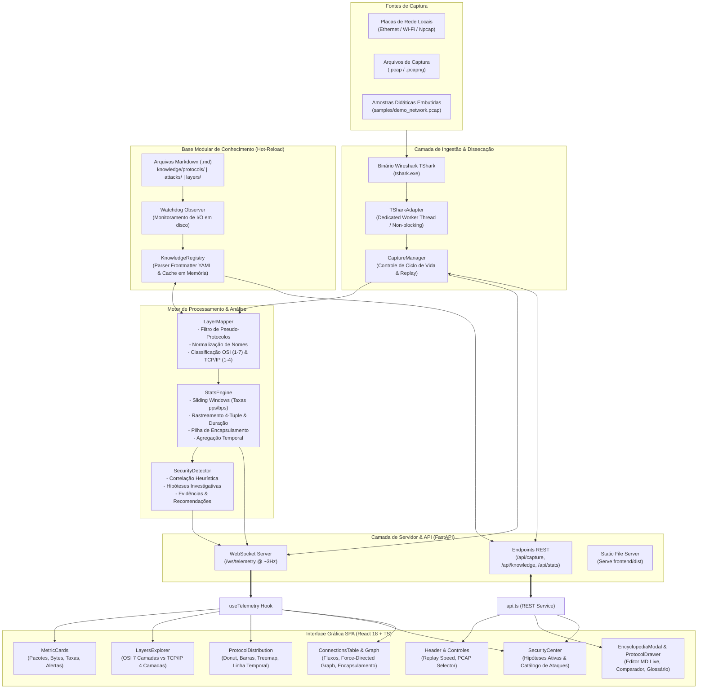
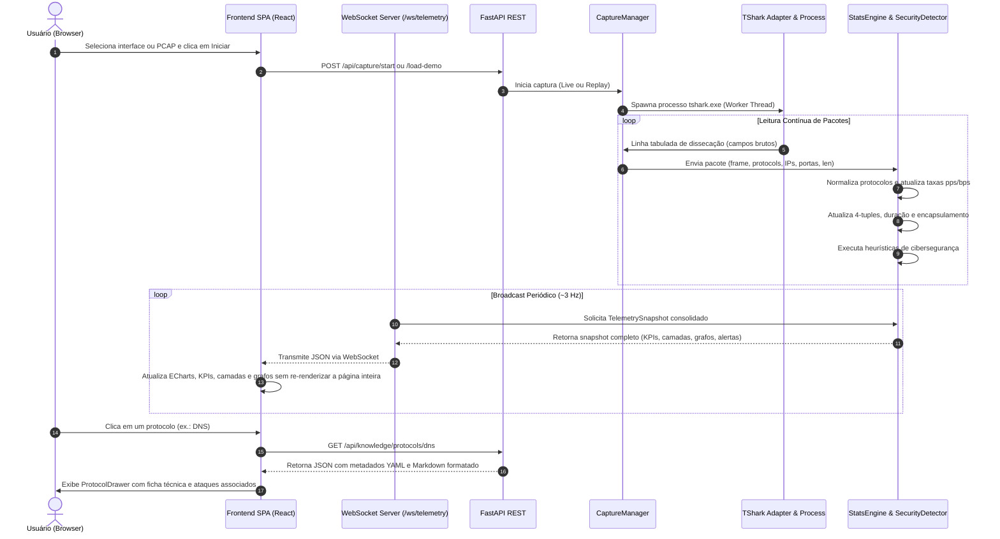

# Arquitetura do Sistema — NetProtocol Explorer
## Plataforma Visual e Interativa de Aprendizado de Redes e Observabilidade

---

## 1. Visão Geral e Objetivo do Projeto

O **NetProtocol Explorer** é uma plataforma moderna, visualmente sofisticada e interativa voltada para a análise, observabilidade e aprendizado de protocolos de redes de computadores e cibersegurança. Diferente de analisadores de pacotes convencionais (focados primariamente em inspeção bruta de campos e listagens extensas de pacotes), o NetProtocol Explorer transforma o tráfego de rede em uma representação gráfica organizada, didática e tecnicamente precisa da arquitetura de comunicação.

### Objetivos Fundamentais:
1. **Compreensão Visual de Protocolos**: Identificar instantaneamente quais protocolos trafegam pela rede e sua distribuição relativa em tempo real.
2. **Classificação Rigorosa em Camadas**: Mapear dinamicamente cada protocolo nos modelos conceituais **OSI (7 camadas)** e **TCP/IP (4 camadas)**, respeitando suas particularidades sem classificações arbitrárias.
3. **Mapeamento de Sessões e Topologia**: Identificar fluxos de comunicação 4-tuple (`Origem:Porta <-> Destino:Porta`), durações de conexões, volumes trafegados e topologias de relacionamento em **Grafos Direcionados por Força (Force-Directed Graph)**.
4. **Inspeção Didática da Pilha de Encapsulamento**: Visualizar a trajetória real do pacote através das camadas (`Enlace -> Rede -> Transporte -> Aplicação`).
5. **Laboratório Educacional de Cibersegurança**: Correlacionar anomalias e padrões de tráfego a hipóteses investigativas estruturadas, sem alarmismo cego, apresentando evidências, hipóteses e recomendações técnicas.
6. **Extensibilidade Modular via Markdown**: Permitir expansão contínua da base de conhecimento (fichas técnicas, portas, ataques) através de arquivos Markdown com metadados YAML e recarregamento a quente (*Hot-Reload* em tempo de execução).

---

## 2. Princípios de Design e Diretrizes da Interface

- **Dark Mode como Padrão**: Estética contemporânea inspirada em ferramentas profissionais de observabilidade (ex.: Grafana, Datadog) e SOC (*Security Operations Centers*).
- **Redução de Ruído Visual**: Substituição de tabelas extensas e interfaces administrativas por cartões de KPIs dinâmicos, gráficos interativos vetoriais e painéis contextuais retráteis (*Drawers* e *Modals*).
- **Feedback em Tempo Real**: Telemetria assíncrona transmitida via WebSockets (~3 snapshots por segundo), fornecendo animações discretas e atualizações fluidas sem engasgos de interface.
- **Interatividade e Rastreabilidade Cruzada**: Clicar em qualquer protocolo nos gráficos, camadas ou tabelas abre sua ficha enciclopédica modular correspondente.

---

## 3. Diagrama Geral da Arquitetura do Sistema



---

## 4. Detalhamento dos Componentes do Backend

O backend é construído em **Python 3.10+ (recomendado 3.12)** utilizando **FastAPI**, **Uvicorn**, **WebSockets**, **Pydantic v2** e **Watchdog**.

### 4.1. Ingestão de Pacotes (`backend/app/capture/`)
- **Descoberta do TShark (`config.py`)**:
  - Localização automática do binário `tshark` em Windows (`C:\Program Files\Wireshark\tshark.exe`), Linux (`/usr/bin/tshark`), macOS (`/Applications/Wireshark.app/Contents/MacOS/tshark`) ou através do `PATH` do sistema. Suporte à variável de ambiente `TSHARK_PATH`.
- **Adaptador TShark (`tshark_adapter.py`)**:
  - Executa o binário do TShark como subprocesso via `subprocess.Popen` com saída estruturada tabulada (`-T fields -E separator=/t`).
  - Utiliza uma **thread dedicada (*daemon thread*)** com leitura síncrona linha a linha para eliminar problemas de travamento de pipes assíncronos no Windows (*asyncio named pipe limitations*).
  - Campos extraídos em tempo real:
    - `frame.number`, `frame.time_epoch`, `frame.len`
    - `frame.protocols` (cadeia completa de dissecação do Wireshark)
    - `ip.src`, `ip.dst`, `ipv6.src`, `ipv6.dst`
    - `tcp.srcport`, `tcp.dstport`, `udp.srcport`, `udp.dstport`
    - `_ws.col.Protocol`, `_ws.col.Info`
- **Controlador de Captura e Replay (`capture_manager.py`)**:
  - Gerencia o ciclo de vida: `start_live`, `start_pcap`, `pause`, `resume`, `clear` e `stop`.
  - **Modo Replay Didático**: Controla o intervalo de envio dos pacotes (`replay_speed`: `0.0` para instantâneo, `0.5x`, `1.0x`, `2.0x`, `5.0x`), permitindo simular tráfego ao vivo a partir de capturas gravadas.

### 4.2. Mapeamento de Camadas e Protocolos (`backend/app/engine/layer_mapper.py`)
- **Filtragem de Ruído de Dissecação**:
  - Remoção automática de pseudo-protocolos internos do Wireshark que não representam protocolos reais de rede (ex.: `frame`, `ethertype`, `data`, `data-text-lines`, `sll`).
- **Normalização de Variantes**:
  - Mapeamento uniforme de aliases comuns (ex.: `ip` $\rightarrow$ `ipv4`, `ssl` / `tlsv1.2` / `tlsv1.3` $\rightarrow$ `tls`, `bootp` $\rightarrow$ `dhcp`).
- **Taxonomia Rigorosa OSI vs. TCP/IP**:
  - Mapeia protocolos para as 7 camadas OSI:
    - *Camada 1 (Física)*: Detecção de meio físico.
    - *Camada 2 (Enlace)*: `eth`, `arp`, `vlan`, `ppp`.
    - *Camada 3 (Rede)*: `ipv4`, `ipv6`, `icmp`, `icmpv6`, `ipsec`, `teredo`.
    - *Camada 4 (Transporte)*: `tcp`, `udp`, `sctp`.
    - *Camada 5 (Sessão)* & *Camada 6 (Apresentação)*: `tls`.
    - *Camada 7 (Aplicação)*: `http`, `https`, `dns`, `dhcp`, `ssh`, `ntp`, `smb`, `smtp`, `ftp`, `snmp`, `quic`, `mqtt`.
  - Mapeia simultaneamente para as 4 camadas da arquitetura TCP/IP (*Enlace*, *Internet*, *Transporte*, *Aplicação*).

### 4.3. Motor de Estatísticas e Topologia (`backend/app/engine/stats_engine.py`)
- **Cálculo de Taxas por Janela Deslizante**:
  - Manutenção de buffer circular das últimas amostras temporais para cálculo contínuo de:
    - Taxa global: `packets_per_second` e `bytes_per_second`.
    - Taxas por protocolo: `packets_per_sec` e `bytes_per_sec`.
- **Rastreamento de Conexões e Sessões (4-Tuples)**:
  - Chave de fluxo bidirecional normalizada: `(IP_A, Porta_A) <-> (IP_B, Porta_B)`.
  - Armazenamento de métricas de sessão: volume em bytes, contagem de pacotes, timestamp inicial, timestamp final e duração precisa (`duration_sec`).
  - **Resolução da Pilha de Encapsulamento**: Decomposição da cadeia de dissecação limpa em ordem de encapsulamento (ex.: `ETH -> IPv4 -> UDP -> TEREDO -> IPv6 -> ICMPv6`).
- **Modelagem de Grafo Force-Directed**:
  - Gera nós representativos para cada host IP único (`nodes`) com:
    - Categoria: `internal` (RFC 1918), `external` (IP público), `multicast` / `broadcast` ou `gateway`.
    - Dimensionamento do diâmetro logarítmico proporcional ao tráfego do nó.
  - Gera arestas direcionadas (`links`) com direção de fluxo, volume agregado e identificação do protocolo de transporte predominante.

### 4.4. Motor Educacional de Cibersegurança (`backend/app/security/detector.py`)
Diferente de sistemas IDS/IPS convencionais de produção (que geram alertas binários de bloqueio), o NetProtocol Explorer foca na **formação analítica do estudante**:
- **Diferenciação Didática**: Uma anomalia não é automaticamente carimbada como invasão; são levantadas **hipóteses investigativas** fundamentadas.
- **Estrutura de cada Alerta**:
  - `id`: Identificador único da ocorrência.
  - `title`: Título claro da hipótese.
  - `protocol`: Protocolo envolvido.
  - `severity`: Nível didático (`low`, `medium`, `high`, `critical`).
  - `evidence`: Evidência observável no tráfego (portas, padrões, contagens de pacotes).
  - `hypothesis`: Hipótese técnica investigativa (ex.: varredura SYN vs. tentativa de conexão sem resposta).
  - `recommendation`: Boas práticas de mitigação e passos recomendados para aprofundamento.
- **Detectores Heurísticos Ativos**:
  - *Port Scanning*: Múltiplas tentativas de conexões TCP/SYN para portas distintas de um mesmo host.
  - *Cleartext HTTP*: Identificação de credenciais ou dados trafegando sem criptografia na camada 7.
  - *IPv6 Teredo Tunneling*: Detecção de tráfego IPv6 encapsulado sobre UDP/IPv4 atravessando bordas NAT.
  - *Anomalias e Volumes DNS*: Consultas repetitivas com padrões compatíveis com enumeração ou exfiltração.
  - *Atividade ARP Broadcast*: Monitoramento de requisições de resolução de endereço e mapeamento de anomalias de cache.

### 4.5. Base Modular de Conhecimento com Hot-Reload (`backend/app/knowledge/`)
- **Organização em Arquivos Markdown (.md)**:
  ```text
  knowledge/
  ├── layers/          # osi.md, tcp-ip.md
  ├── protocols/       # application/, transport/, network/, data-link/
  ├── attacks/         # dns-spoofing.md, syn-flood.md, port-scanning.md...
  ├── ports/           # well-known-ports.md, registered-ports.md
  └── glossary/        # networking-terms.md
  ```
- **Metadados Padronizados via YAML Frontmatter**:
  ```yaml
  ---
  id: dns
  name: Domain Name System
  acronym: DNS
  osi_layer: 7
  tcp_ip_layer: application
  transport: [UDP, TCP]
  ports: [53]
  related_protocols: [udp, tcp, tls]
  attacks: [dns-spoofing, dns-tunneling, dns-amplification]
  ---
  ```
- **Hot-Reload em Tempo de Execução via Watchdog**:
  - O `knowledge_watcher.py` escuta eventos do sistema de arquivos na pasta `knowledge/`.
  - Ao criar, editar ou excluir qualquer arquivo `.md`, o registro é reanalisado em milissegundos sem reiniciar a aplicação ou desconectar os clientes WebSocket.
  - Suporte à edição direta através do editor embutido na interface (`ProtocolDrawer`).

---

## 5. Detalhamento dos Componentes do Frontend

O frontend é uma Single Page Application (SPA) construída com **React 18**, **TypeScript**, **Vite** e **Tailwind CSS**, utilizando **Apache ECharts** (`echarts-for-react`) para renderização gráfica de alta performance com aceleração por Canvas.

### 5.1. Dashboard Principal
1. **Header (`Header.tsx`)**:
   - Seletor de interface de captura ao vivo ou seletor de arquivos de demonstração (`demo_network.pcap`, `tese.pcapng`).
   - Seletor de velocidade de replay (`Instantâneo`, `0.5x`, `1x`, `2x`, `5x`).
   - Botões de controle de captura: *Iniciar*, *Pausar*, *Limpar* e *Parar*.
   - Indicador de pulso de conexão WebSocket em tempo real.
2. **Cartões de Métricas (`MetricCards.tsx`)**:
   - *Total de Pacotes* (com taxa instantânea `pkts/s`).
   - *Volume de Dados* (formatado em B/KB/MB com taxa `bps/Kbps/Mbps`).
   - *Protocolos Ativos* identificados.
   - *Sessões & Conexões* ativas rastreadas.
   - *Endereços IP Únicos* mapeados.
   - *Indicadores de Cibersegurança & Alertas* com latência de processamento do motor.
3. **Explorador de Camadas (`LayersExplorer.tsx`)**:
   - Visualização hierárquica gráfica com chaveamento instantâneo entre **Modelo OSI (7 Camadas)** e **Modelo TCP/IP (4 Camadas)**.
   - Barras de preenchimento proporcional de pacotes e bytes por camada.
   - Badges clicáveis de todos os protocolos identificados em cada camada que abrem diretamente a enciclopédia.
4. **Distribuição & Evolução de Protocolos (`ProtocolDistribution.tsx`)**:
   - 4 Gráficos interativos em Apache ECharts:
     - **Gráfico de Rosca (Donut)** com proporção percentual.
     - **Gráfico de Barras Horizontais** ranqueado.
     - **Treemap Hierárquico** para visualização de densidade.
     - **Evolução Temporal (Linha do Tempo)** mostrando a trajetória temporal de cada protocolo na captura.
   - 4 Modos de métrica: `% por Pacotes`, `% por Bytes`, `Quantidade Absoluta` e `Taxa por Segundo (pkts/s)`.
5. **Centro de Cibersegurança (`SecurityCenter.tsx`)**:
   - Alternância entre **Hipóteses Ativas na Captura** e **Catálogo Didático de Ameaças**.
   - Cartões com insígnias de severidade, evidência observada, hipótese investigativa, recomendações de segurança e links diretos para estudar o protocolo ou o vetor de ataque.
6. **Mapeamento de Comunicações & Topologia (`ConnectionsTable.tsx`)**:
   - Alternância entre **Matriz de Fluxos** e **Grafo Force-Directed Interativo**.
   - Tabela de fluxos com busca textual, ordenação por duração, volume ou pacotes, e botão de inspeção da pilha de encapsulamento (`EncapsulationModal`).
   - Grafo de nós com física elástica em tempo real, nós arrastáveis, zoom, pan, cores por zona de rede e realce visual de vizinhança de comunicação.
7. **Centro Educacional & Enciclopédia (`EncyclopediaModal.tsx` & `ProtocolDrawer.tsx`)**:
   - Catálogo pesquisável com filtros por camada OSI.
   - **Comparador Lado a Lado**: Compara simultaneamente as especificações de dois protocolos (ex.: TCP vs. UDP).
   - **Glossário Técnico de Redes**: Consulta integrada aos termos fundamentais da área.
   - **Editor Markdown Ao Vivo**: Permite editar e salvar alterações diretamente no arquivo de disco a partir da própria interface.

---

## 6. Fluxo de Dados e Comunicação

### 6.1. Diagrama de Sequência — Ciclo de Captura e Telemetria



---

## 7. Estrutura do Repositório de Código

```text
NetProtocol-Explorer/
├── backend/
│   ├── app/
│   │   ├── config.py                 # Configurações globais e resolução do binário TShark
│   │   ├── main.py                   # Servidor FastAPI, rotas REST, WebSocket e SPA static mount
│   │   ├── capture/
│   │   │   ├── tshark_adapter.py     # Subprocesso TShark em worker thread dedicada
│   │   │   └── capture_manager.py    # Gerenciamento de ciclo de vida e broadcast WebSocket
│   │   ├── engine/
│   │   │   ├── layer_mapper.py       # Classificação rigorosa OSI (1-7) e TCP/IP (1-4)
│   │   │   └── stats_engine.py       # Agregador de taxas deslizantes, fluxos e grafo de nós
│   │   ├── security/
│   │   │   └── detector.py           # Motor de correlação heurística e hipóteses investigativas
│   │   ├── knowledge/
│   │   │   ├── models.py             # Modelos de metadados YAML dos protocolos e ataques
│   │   │   ├── parser.py             # Parser de frontmatter YAML e corpo Markdown
│   │   │   ├── registry.py           # Registro e índice em memória com consultas cruzadas
│   │   │   └── watcher.py            # Observer de I/O em tempo real baseado em Watchdog
│   │   └── models/
│   │       └── schemas.py            # Schemas Pydantic v2 de telemetria, nós e alertas
│   └── tests/                        # Testes automatizados do motor, conhecimento e grafos
├── frontend/
│   ├── src/
│   │   ├── components/
│   │   │   ├── layout/Header.tsx     # Barra superior com controles de captura e replay
│   │   │   ├── dashboard/MetricCards.tsx # KPIs globais do tráfego
│   │   │   ├── layers/LayersExplorer.tsx # Mapeamento hierárquico OSI vs. TCP/IP
│   │   │   ├── protocols/ProtocolDistribution.tsx # Gráficos ECharts (Donut, Treemap, Timeline)
│   │   │   ├── security/SecurityCenter.tsx # Painel de hipóteses e matriz de ameaças
│   │   │   ├── connections/          # Tabela de sessões, Grafo Force-Directed e Encapsulamento
│   │   │   └── encyclopedia/         # Drawer contextual, comparador e catálogo educacional
│   │   ├── hooks/useTelemetry.ts     # Hook cliente WebSocket com reconexão automática
│   │   ├── services/api.ts           # Cliente HTTP REST tipado
│   │   └── types/index.ts            # Definições estritas de tipos TypeScript
│   └── dist/                         # Bundle de produção otimizado servido pelo FastAPI
├── knowledge/                        # Base modular extensível de conhecimento em Markdown
│   ├── layers/                       # osi.md, tcp-ip.md
│   ├── protocols/                    # application/, transport/, network/, data-link/
│   ├── attacks/                      # dns-spoofing, port-scanning, syn-flood, teredo...
│   ├── ports/                        # well-known-ports.md, registered-ports.md
│   └── glossary/                     # networking-terms.md
├── samples/                          # Capturas didáticas (demo_network.pcap, tese.pcapng)
├── docs/
│   └── architecture.md               # Esta documentação arquitetural completa
├── requirements.txt                  # Dependências Python para instalação
├── install.bat / install.ps1         # Instalador em 1 clique para nova máquina
├── start.bat / start.ps1             # Inicializador do servidor e abertura de navegador
├── LICENSE                           # PolyForm Noncommercial License 1.0.0 (Código-Fonte)
└── LICENSE-DOCS                      # Creative Commons BY-NC 4.0 (Documentação e Knowledge)
```

---

## 8. Considerações de Desempenho e Segurança

1. **Eficiência no Tratamento de I/O de Rede**:
   - O TShark opera em modo de baixa sobrecarga (`-l -n`), sem realizar resolução reversa de DNS em nível de pacote para evitar latência na fila de dissecação.
   - O consumo do output do TShark é descarregado em uma *worker thread* desacoplada do loop de eventos assíncrono do FastAPI, assegurando latências inferiores a 5 ms no processamento da telemetria.
2. **Prevenção de Sobrecarga no Navegador**:
   - A telemetria é compactada e agregada no backend. Mesmo em redes com dezenas de milhares de pacotes por segundo, o servidor WebSocket transmite snapshots consolidados em uma taxa controlada (~3 vezes por segundo), mantendo a renderização da interface fluida a 60 FPS.
3. **Segurança e Isolamento Operacional**:
   - A captura de rede exige privilégios de administrador apenas para acesso aos drivers de camada de enlace (Npcap no Windows ou permissões de captura no Linux).
   - O servidor local por padrão vincula-se ao endereço de loopback (`127.0.0.1`), prevenindo exposição acidental da interface analítica em redes não confiáveis.
